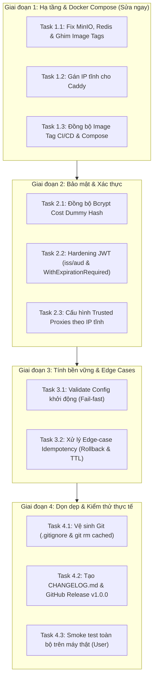

# Kế hoạch Triển khai Chi tiết (Atomic Tasks Roadmap)

Kế hoạch này phân rã 12 góp ý thành 4 giai đoạn với **10 task nhỏ độc lập (micro-tasks)**. Mỗi task được thiết kế theo nguyên tắc:
- **Tập trung vào 1-2 file duy nhất**: Agent chỉ cần đọc và sửa phạm vi hẹp.
- **Có tiêu chí nghiệm thu rõ ràng (Verification Criteria)**: Agent có thể tự chạy test/linter kiểm tra ngay trước khi kết thúc prompt.
- **Độc lập và có thể chạy trong 1 prompt**: Tránh rủi ro agent bị out-of-context hay sửa dở dang.

---

## Tổng quan các giai đoạn



---

## Bảng Theo dõi Tiến độ (Progress Tracker)

### Giai đoạn 1: Hạ tầng & Docker Compose
- [x] **Task 1.1**: Sửa MinIO, Redis Requirepass & Ghim Image Tags *(Hoàn thành)*
- [x] **Task 1.2**: Cấu hình IP tĩnh cho Caddy trong Bridge Network *(Hoàn thành)*
- [x] **Task 1.3**: Đồng bộ Image Tag giữa CI/CD Pipeline và Docker Compose *(Hoàn thành)*

### Giai đoạn 2: Bảo mật & Xác thực
- [x] **Task 2.1**: Đồng bộ Bcrypt Cost cho Dummy Hash (Chống Timing Attack) *(Hoàn thành)*
- [x] **Task 2.2**: Hardening JWT Validation & Đưa Claims vào Config *(Hoàn thành)*
- [x] **Task 2.3**: Giới hạn Trusted Proxies theo IP tĩnh của Caddy *(Hoàn thành)*

### Giai đoạn 3: Tính bền vững & Xử lý Edge Cases
- [ ] **Task 3.1**: Validate Cấu hình khi Khởi động (Fail-fast trong Production)
- [ ] **Task 3.2**: Xử lý Edge-case Kẹt Khóa Idempotency

### Giai đoạn 4: Dọn dẹp & Phát hành
- [ ] **Task 4.1**: Vệ sinh Git Repository & Cập nhật .gitignore
- [ ] **Task 4.2**: Soạn thảo CHANGELOG.md & Chuẩn bị Release v1.0.0
- [ ] **Task 4.3**: Hướng dẫn Smoke Test Thực tế trên Máy thật

---

## Chi tiết từng Giai đoạn & Task

### GIAI ĐOẠN 1: Hạ tầng & Docker Compose (Ưu tiên số 1 - Sửa ngay)

#### [x] Task 1.1: Sửa MinIO, Redis Requirepass & Ghim Image Tags *(Hoàn thành)*
- **Mục tiêu:** Đảm bảo toàn bộ stack container có thể khởi động thành công và an toàn trên môi trường production.
- **Giải quyết Feedback:** #2 (MinIO), #7 (Redis auth), #12 (Ghim tag).
- **Phạm vi file:** `docker-compose.prod.yml`
- **Các bước thực hiện:**
  1. Đổi image MinIO từ `cgr.dev/chainguard/minio:latest` sang official image có ngày release cụ thể (ví dụ `minio/minio:RELEASE.2024-11-07T00-52-28Z`). Giữ nguyên hoặc chuẩn hóa healthcheck `mc ready local`.
  2. Bổ sung `command: ["redis-server", "--requirepass", "${REDIS_PASSWORD}"]` cho service Redis.
  3. Ghim phiên bản cụ thể cho các image còn lại: `postgres:16-alpine`, `redis:7-alpine`, `caddy:2.8-alpine`.
- **Kiểm tra hoàn thành:** `docker compose -f docker-compose.prod.yml config` không báo lỗi cú pháp.

#### [x] Task 1.2: Cấu hình IP tĩnh cho Caddy trong Bridge Network *(Hoàn thành)*
- **Mục tiêu:** Chuẩn bị IP tĩnh cho Reverse Proxy để phục vụ việc hạn chế Trusted Proxies ở tầng API.
- **Giải quyết Feedback:** #5 (phần hạ tầng Docker).
- **Phạm vi file:** `docker-compose.prod.yml`
- **Các bước thực hiện:**
  1. Định nghĩa cấu hình subnet tĩnh trong block `networks` (ví dụ subnet `172.28.0.0/16`).
  2. Gán `ipv4_address: 172.28.0.2` cố định cho service Caddy.
- **Kiểm tra hoàn thành:** `docker compose -f docker-compose.prod.yml config` hợp lệ, network map chính xác.

#### [x] Task 1.3: Đồng bộ Image Tag giữa CI/CD Pipeline và Docker Compose *(Hoàn thành)*
- **Mục tiêu:** Ngăn chặn lỗi không pull được image do lệch định dạng `v1.0.0` và `1.0.0`.
- **Giải quyết Feedback:** #1, #12 (phần CI Go version).
- **Phạm vi file:** `.github/workflows/deploy.yml` (hoặc workflow build docker), `docker-compose.prod.yml`
- **Các bước thực hiện:**
  1. Trong workflow build Docker (`docker/metadata-action`), thêm cả `type=semver,pattern={{version}}` và `type=ref,event=tag` (hoặc `type=semver,pattern=v{{version}}`) để đẩy đồng thời cả tag `1.0.0` và `v1.0.0`.
  2. Trong `docker-compose.prod.yml`, chuẩn hóa giá trị fallback: `${IMAGE_TAG:-1.0.0}`.
  3. Ghim `go-version` trong CI thành minor version cụ thể (ví dụ `'1.23'`).
- **Kiểm tra hoàn thành:** Linter workflow YAML pass, cấu hình tag fallback khớp với tag sinh ra từ CI.

---

### GIAI ĐOẠN 2: Bảo mật & Xác thực (Ưu tiên số 2)

#### [x] Task 2.1: Đồng bộ Bcrypt Cost cho Dummy Hash (Chống Timing Attack) *(Hoàn thành)*
- **Mục tiêu:** Triệt tiêu hoàn toàn khả năng dò quét user qua thời gian phản hồi API login.
- **Giải quyết Feedback:** #4.
- **Phạm vi file:** `internal/service/auth_service.go` (hoặc `internal/pkg/hasher/`)
- **Các bước thực hiện:**
  1. Bỏ chuỗi dummy hash hardcode cost 10 (`$2a$10$...`).
  2. Khi khởi tạo `AuthService`, truyền `hasher` (cost 12) vào hoặc tính toán trước 1 chuỗi dummy hash ngẫu nhiên dùng đúng cost 12 lúc server khởi động.
  3. Đảm bảo thời gian chạy `CompareHashAndPassword` của dummy hash bằng $100\%$ thời gian hash thật.
- **Kiểm tra hoàn thành:** Chạy unit test xác thực `go test -v ./internal/service/...`.

#### [x] Task 2.2: Hardening JWT Validation & Đưa Claims vào Config *(Hoàn thành)*
- **Mục tiêu:** Chống lỗ hổng bypass token không có hạn sử dụng (`exp`) và linh hoạt môi trường deploy.
- **Giải quyết Feedback:** #10.
- **Phạm vi file:** `internal/pkg/jwt/` hoặc `internal/service/token_service.go`, `internal/config/config.go`
- **Các bước thực hiện:**
  1. Đọc `JWT_ISSUER` và `JWT_AUDIENCE` từ biến môi trường/config struct thay vì dùng hằng số.
  2. Khi parse/validate token với `golang-jwt/jwt/v5`, bổ sung các parser option:
     - `jwt.WithExpirationRequired()` (bắt buộc phải có claim exp).
     - `jwt.WithIssuer(cfg.JWTIssuer)`
     - `jwt.WithAudience(cfg.JWTAudience)`
- **Kiểm tra hoàn thành:** Unit test kiểm tra token thiếu exp bị từ chối; token sai issuer/audience bị từ chối.

#### [x] Task 2.3: Giới hạn Trusted Proxies theo IP tĩnh của Caddy *(Hoàn thành)*
- **Mục tiêu:** Ngăn chặn giả mạo IP client qua header `X-Forwarded-For`.
- **Giải quyết Feedback:** #5 (phần ứng dụng).
- **Phạm vi file:** `cmd/api/main.go` hoặc middleware cấu hình router (Gin/Echo)
- **Các bước thực hiện:**
  1. Thay thế cấu hình trusted proxies (hiện đang là cả dải `/16` hoặc `0.0.0.0/0`) bằng IP tĩnh được cấu hình từ config (`TRUSTED_PROXIES`).
  2. Giá trị mặc định trỏ đúng về IP của Caddy (`172.28.0.2`).
- **Kiểm tra hoàn thành:** Unit test/route test kiểm tra request đi qua proxy nhận đúng Client IP.

---

### GIAI ĐOẠN 3: Tính bền vững & Xử lý Edge Cases (Fail-fast & Robustness)

#### [x] Task 3.1: Validate Cấu hình khi Khởi động (Fail-fast trong Production) *(Hoàn thành)*
- **Mục tiêu:** Ngăn ngừa việc chạy nhầm các cấu hình mặc định thiếu an toàn trên production.
- **Giải quyết Feedback:** #6.
- **Phạm vi file:** `internal/config/config.go`, `cmd/api/main.go`
- **Các bước thực hiện:**
  1. Viết phương thức `Validate(env string) error` trong struct `Config`.
  2. Nếu `env == "production"`:
     - Từ chối nếu `JWT_SECRET` trùng với secret mẫu trong `.env.example`.
     - Từ chối nếu S3 access key / secret key là `minioadmin`.
     - Từ chối nếu CORS allowed origins chứa `localhost`, `127.0.0.1` hoặc `*`.
     - Kiểm tra đảm bảo `WriteTimeout` của HTTP Server $\ge$ `RequestTimeout`.
  3. Gọi `cfg.Validate(cfg.AppEnv)` ngay đầu hàm `main()`, nếu có lỗi thì `log.Fatalf` dừng server ngay.
- **Kiểm tra hoàn thành:** Unit test `config_test.go` cho các trường hợp config không hợp lệ ở production.

#### [x] Task 3.2: Xử lý Edge-case Kẹt Khóa Idempotency *(Hoàn thành)*
- **Mục tiêu:** Đảm bảo khi lưu response thất bại, client không bị chặn retry suốt 24 giờ.
- **Giải quyết Feedback:** #11.
- **Phạm vi file:** `internal/middleware/idempotency.go` (hoặc service idempotency)
- **Các bước thực hiện:**
  1. Tách biệt 2 mức TTL:
     - Khóa đang xử lý (`PROCESSING`): TTL ngắn (ví dụ: 30s – 60s).
     - Kết quả hoàn tất (`COMPLETED`): TTL dài (24 giờ).
  2. Bổ sung cơ chế cleanup/rollback: nếu handler trả về lỗi hoặc bước lưu response xuống Redis/DB thất bại, chủ động xóa key (`DEL key`) trong block xử lý lỗi để client có thể retry ngay lập tức.
- **Kiểm tra hoàn thành:** Unit test mô phỏng bước lưu response bị lỗi, kiểm tra key Redis đã được giải phóng.

---

### GIAI ĐOẠN 4: Dọn dẹp & Phát hành (Cleanliness & Delivery)

#### [x] Task 4.1: Vệ sinh Git Repository & Cập nhật .gitignore *(Hoàn thành)*
- **Mục tiêu:** Làm sạch repo trước khi release, không theo dõi các file tài liệu nháp và thư mục nội bộ agent.
- **Giải quyết Feedback:** #8.
- **Phạm vi file:** `.gitignore`, Git index
- **Các bước thực hiện:**
  1. Thêm `.agents/` và `*.md` nháp vào `.gitignore`.
  2. Chạy `git rm -r --cached .agents/skills/` (giữ file local, bỏ khỏi git).
  3. Chạy `git rm --cached "Kế hoạch dự án Task Manager REST API.md"`.
- **Kiểm tra hoàn thành:** `git status` hiển thị các file trên ở trạng thái untracked/ignored.

#### [x] Task 4.2: Soạn thảo CHANGELOG.md & Chuẩn bị Release v1.0.0 *(Hoàn thành)*
- **Mục tiêu:** Hoàn thiện hồ sơ phát hành chính thức cho phiên bản v1.0.0.
- **Giải quyết Feedback:** #9.
- **Phạm vi file:** `CHANGELOG.md`, `release_notes.md`
- **Các bước thực hiện:**
  1. Tạo file `CHANGELOG.md` theo chuẩn Keep a Changelog.
  2. Soạn nội dung Release Notes cho tag `v1.0.0`: liệt kê tính năng chính, breaking changes, cấu hình môi trường mới và các bản vá bảo mật.
- **Kiểm tra hoàn thành:** File `CHANGELOG.md` đầy đủ nội dung, đúng format Markdown.

#### Task 4.3: Hướng dẫn Smoke Test Thực tế trên Máy thật (Dành cho Người dùng)
- **Mục tiêu:** Kiểm tra tích hợp toàn diện từ đầu đến cuối trên máy thật trước khi bàn giao.
- **Giải quyết Feedback:** #3.
- **Các bước thực hiện bởi người dùng:**
  1. Xóa toàn bộ volume cũ để test cold start:
     ```bash
     docker compose -f docker-compose.prod.yml down -v
     docker compose -f docker-compose.prod.yml up -d --build
     ```
  2. Kiểm tra trạng thái các container:
     ```bash
     docker compose -f docker-compose.prod.yml ps
     ```
     *(Đảm bảo tất cả services bao gồm API, MinIO, Redis, Postgres, Caddy đều `Up` và `healthy`)*.
  3. Kiểm tra tab GitHub Actions trên repository: đảm bảo workflow CI cho tag `v1.0.0` xanh hoàn toàn.
  4. Đẩy Release Notes lên GitHub Release tương ứng với tag `v1.0.0`.

---

## Cách đưa từng Task cho Agent thực hiện (Prompt Template)

Khi bạn muốn agent làm task nào, chỉ cần gửi một prompt ngắn gọn theo mẫu sau:

```text
Hãy thực hiện [Task X.Y: Tên Task] theo kế hoạch:
- File cần chỉnh sửa: [Đường dẫn file]
- Yêu cầu chi tiết: [Trích các bước trong task]
- Tiêu chí nghiệm thu: [Chạy lệnh test tương ứng]
Chỉ tập trung sửa đúng phạm vi task này và kiểm tra test trước khi hoàn thành.
```
