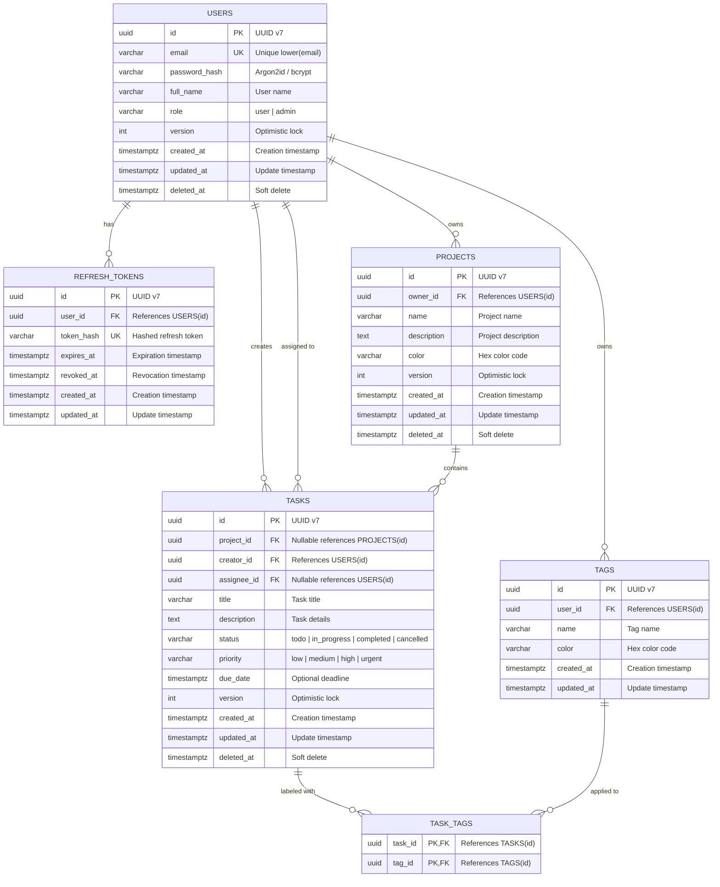

# Entity-Relationship Diagram (ERD)

This document describes the relational database schema design for the **Task Manager REST API**.

---

## 1. Mermaid ERD

---

## 2. Key Design Standards

1. **Primary Keys**:
   - Time-ordered UUIDs (UUID v7) generate monotonically increasing IDs that preserve B-Tree index locality and avoid fragmentation compared to random UUID v4.
2. **Timestamps & Timezones**:
   - All datetime fields use `TIMESTAMPTZ` (UTC).
3. **Soft Delete (`deleted_at`)**:
   - Entities (`users`, `projects`, `tasks`) have a nullable `deleted_at` timestamp. Records where `deleted_at IS NULL` are active.
4. **Optimistic Locking (`version`)**:
   - Integer column incremented on every update (`UPDATE ... SET version = version + 1 WHERE id = $1 AND version = $2`). Prevents concurrent overwrite conflicts.
5. **Integrity & Constraints**:
   - Case-insensitive unique emails using a unique index on `lower(email)`.
   - `CHECK` constraints on enumeration fields:
     - `users.role`: `'user'`, `'admin'`
     - `tasks.status`: `'todo'`, `'in_progress'`, `'completed'`, `'cancelled'`
     - `tasks.priority`: `'low'`, `'medium'`, `'high'`, `'urgent'`
   - Foreign key cascading:
     - Deleting a user cascades to their projects, tasks, refresh tokens, and tags.
     - Deleting a project sets `tasks.project_id` to `NULL`.
     - Deleting a task or tag cascades deletion to `task_tags`.
