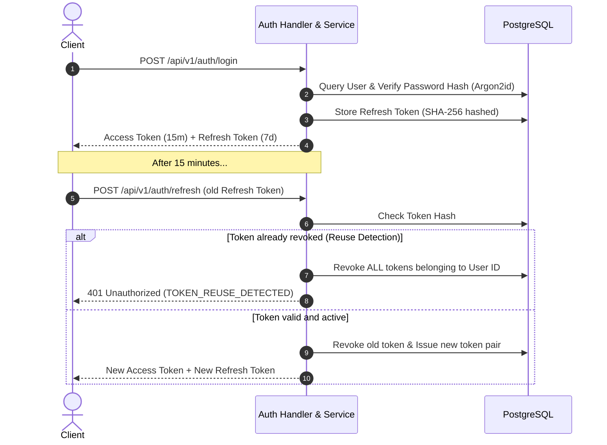
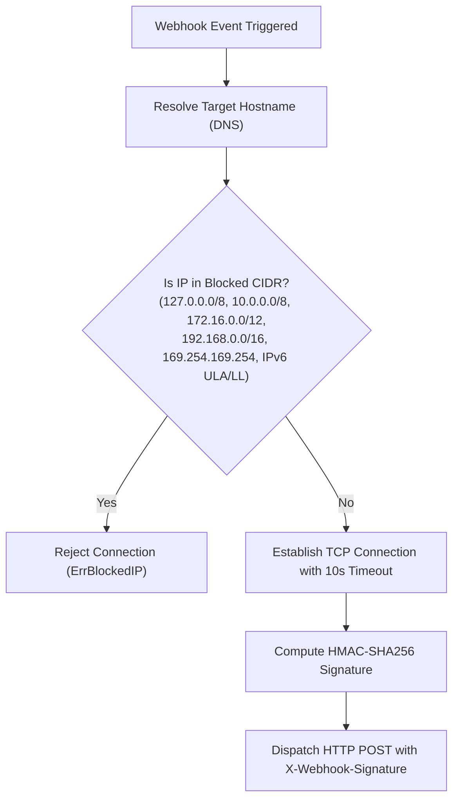

# Security Policy & OWASP API Security Top 10 Audit

This document details the security architecture, threat model mitigations, and compliance review for the **Task Manager REST API** against the **OWASP API Security Top 10 (2023)**.

---

## 1. Security Architecture Overview

The Task Manager REST API is designed with defense-in-depth security principles across all layers:
- **Network & Gateway Layer**: OWASP Security Headers (HSTS, CSP, X-Frame-Options, X-Content-Type-Options, Referrer-Policy), explicit CORS origin allowlisting (no wildcards), Caddy reverse proxy with automatic HTTPS and HTTP-to-HTTPS redirect, and per-client IP Token Bucket rate limiting.
- **Transport & Request Pipeline**: Strict 2MB request body ceiling (`http.MaxBytesReader`), request context cancellation deadlines (`30s`), and IETF `Idempotency-Key` concurrency protection.
- **Authentication & Session Security**: Argon2id password hashing (RFC 9106 params: m=64MB, t=3, p=2), Ed25519/HMAC-SHA256 JWT access tokens (15m TTL), and SHA-256 hashed refresh tokens with automatic token family revocation upon reuse detection.
- **Data Layer Isolation & Multi-Tenancy**: PostgreSQL connection pooling with `statement_timeout` (10s), multi-tenant Anti-IDOR scoping (`WHERE id = $1 AND user_id = $2`) returning `404 Not Found`, and project role-based access control (`project_members`).
- **Egress & Webhook Security**: Safe HTTP client with strict SSRF protection (DNS re-resolution before dial, loopback/private/link-local/CGNAT/IMDS IP range blocking), and HMAC-SHA256 signature verification (`X-Webhook-Signature`).
- **Configuration Hardening**: Strict environment validation (`APP_ENV` strictly enforced; `GIN_MODE=release` and non-empty `REDIS_PASSWORD` required in production; `RequestTimeout < InProgressLockTTL`), production gating on `/swagger/*` and `/metrics` (returning `403 Forbidden`), and base container images pinned by immutable SHA-256 digests.

---

## 2. OWASP API Security Top 10 (2023) Compliance Matrix

| Vulnerability Category | Risk Level | Status | Implemented Protection Mechanisms |
| :--- | :--- | :--- | :--- |
| **API1:2023 Broken Object Level Authorization (BOLA / IDOR)** | High | **Protected** | Multi-tenant Anti-IDOR query scoping (`WHERE id = $1 AND user_id = $2`). Project resources (tasks, comments, attachments) enforce project membership and role permissions (`project_members`). Resource lookup failures return RFC 9457 `404 Not Found` (never 403) to prevent resource existence enumeration. |
| **API2:2023 Broken Authentication** | Critical | **Protected** | Argon2id password hashing (RFC 9106 recommended). Dual-token JWT flow (15m access / 7d refresh). Refresh tokens stored as SHA-256 hashes with automatic token reuse detection revoking all active sessions for the user. |
| **API3:2023 Broken Object Property Level Authorization** | Medium | **Protected** | Strict DTO segregation (`CreateTaskRequest`, `UpdateTaskRequest`). No mass assignment (`c.ShouldBindJSON` strictly bounds permitted fields). Response DTOs strip sensitive database fields; user emails are completely omitted from public/collaborative endpoints (`CommentResponse`) and webhook payloads (`author` and `user_id` preserved). |
| **API4:2023 Unrestricted Resource Consumption** | High | **Protected** | Strict `MaxBytes(2MB)` payload ceiling. Distributed / In-memory Token Bucket rate limiter on auth routes (5 req/min burst 10) partitioned by client IP. Keyset cursor pagination caps `limit` at 100. Global `TimeoutMiddleware(30s)` and PostgreSQL `statement_timeout(10s)`. |
| **API5:2023 Broken Function Level Authorization (BFLA)** | High | **Protected** | Role-Based Access Control (`RequireRole("admin")`) for administrative actions. Project-level authorization (`owner`, `editor`, `viewer`); viewers are strictly blocked from mutation endpoints. User identity extracted exclusively from verified cryptographically signed JWT claims, not user-controllable headers. |
| **API6:2023 Unrestricted Access to Sensitive Business Flows** | Medium | **Protected** | Per-client IP rate limiting on `/api/v1/auth/*`. IETF `Idempotency-Key` header with in-flight mutual exclusion locking on `POST /api/v1/tasks`. Race-safe concurrency control: conditional stale lock deletion using `locked_at` and HTTP 409 `IDEMPOTENCY_IN_PROGRESS` on race collisions. |
| **API7:2023 Server Side Request Forgery (SSRF)** | High | **Protected** | Webhook dispatcher utilizes `safehttp.Client` custom dialer enforcing DNS re-resolution before connection. Outbound connections to private, loopback, link-local, and cloud metadata ranges (RFC 1918, RFC 3927, RFC 6598 CGNAT, IPv6 ULA/LL, AWS IMDS `169.254.169.254`) are strictly rejected. Internal databases and caches reside on isolated Docker bridge networks without public exposure. |
| **API8:2023 Security Misconfiguration** | High | **Protected** | Reverse proxy trust disabled by default (`router.SetTrustedProxies(nil)`). Strict environment validation (`APP_ENV` strictly development, staging, production, test; production mandates `GIN_MODE=release` and non-empty `REDIS_PASSWORD`). CORS configured with explicit allowed origins (no wildcard `*`). OWASP security headers enforced (HSTS, CSP, Frame-Options DENY). RFC 9457 masks internal errors. Base container images pinned by immutable SHA-256 digests. |
| **API9:2023 Improper Inventory Management** | Low | **Protected** | Strict API versioning under `/api/v1/`. Interactive OpenAPI 3.0 / Swagger UI documentation at `/swagger/index.html`. Production gating: `/swagger/*` and `/metrics` return HTTP 403 Forbidden in production mode (`APP_ENV=production` or `GIN_MODE=release`). |
| **API10:2023 Unsafe Consumption of APIs** | Medium | **Protected** | Input parameter validation via `go-playground/validator/v10` and custom domain business rule validators before processing. Strongly typed DTO unmarshaling. Webhook payloads signed with HMAC-SHA256 (`X-Webhook-Signature`) with timestamp tolerance verification. |

---

## 3. Threat Modeling & Implementation Details

### 3.1 Anti-IDOR & Information Leak Prevention (API1)
In multi-tenant architectures, returning `403 Forbidden` when a user attempts to view a resource owned by another tenant leaks the information that the resource **exists**.
To counteract this threat:
- All direct user queries require both `id` and `user_id`.
- For collaborative entities (projects, tasks, comments, attachments), the user's project membership is verified.
- If no row matches or access is unauthorized, the service returns `domain.ErrNotFound`, which maps to RFC 9457 `404 Not Found`. An attacker cannot distinguish between a non-existent UUID and a resource owned by someone else.

### 3.2 Dual-Token Authentication & Session Revocation (API2)


### 3.3 SSRF Protection for Webhook Dispatcher (API7)
Outbound webhook deliveries are protected against Server-Side Request Forgery via a hardened HTTP transport:


### 3.4 IETF Idempotency-Key Mechanism & Concurrency Control (API6)
The API implements mutation idempotency via the `Idempotency-Key` header:
1. **Key Reservation**: When a mutation request arrives with `Idempotency-Key: <key>`, the middleware attempts an atomic insert into `idempotency_keys` with `params_hash = SHA256(body)` and `locked_at = NOW()`.
2. **Concurrent Request Handling**: If a simultaneous request arrives with the same key before the first completes, the second receives `409 Conflict` (`IDEMPOTENCY_IN_PROGRESS`). If a unique race condition occurs during key reset, the transaction aborts with HTTP 409 instead of 500.
3. **Stale Lock Cleanup**: Expired in-progress locks (older than `InProgressLockTTL`) are conditionally deleted by `locked_at` rather than key alone, preventing race conditions with freshly acquired locks.
4. **Payload Mismatch Detection**: If a client re-uses a key with altered request parameters, the middleware detects `params_hash != existing.params_hash` and rejects with `409 Conflict` (`IDEMPOTENCY_KEY_MISMATCH`).
5. **Cached Replay**: Once the first request succeeds (status 2xx or 4xx), the status code and serialized response body are saved. Subsequent retries receive the exact cached response with `Idempotent-Replayed: true`.

---

## 4. Automated Security Audit Results & Tooling

The codebase is continuously verified using a defense-in-depth suite of automated security scanners in the CI pipeline and pre-release audits.

### 4.1 Security Scan Results Matrix (Audited: 2026-11-22, Commit: 6da67f3)

| Security Tool | Version | Scan Date | Scope | Findings Count | Severity Breakdown | Status / Resolution |
| :--- | :--- | :--- | :--- | :--- | :--- | :--- |
| **govulncheck** | `v1.9.0` | 2026-11-27 | Direct Go dependencies, stdlib & symbols (`./...`) | **0 vulnerabilities** | 0 Critical, 0 High | Direct imports and Go standard library completely clean. Standard library advisories GO-2026-6859 and GO-2026-6809 are resolved by pinning toolchain to `go1.27.4` in `go.mod` and Dockerfile builder. |
| **gosec** | `v2.30.0` | 2026-11-22 | Go AST static analysis (`./...`) | **0 real vulnerabilities** (9 false positives triaged) | 0 Critical, 0 High exploitable | 9 static pattern matches reviewed and dismissed: 5 SQL query constants in `refresh_tokens.sql.go` containing table name "token" (G101), 1 worker task name string constant (G101), 2 bounded integer conversions with timeout/status guarantees (G115), 1 webhook secret payload marshaling for HMAC signing (G117). `scripts/webhook-receiver` verified clean (G114 resolved). |
| **Trivy** | `v0.76.2` (Action `v0.36.0`) | 2026-11-22 | Production Container Image (`ghcr.io/nmhiepasd/task-manager-api:1.0.0`) | **0 container vulnerabilities** | 0 Critical, 0 High (unfixed) | Multi-stage distroless/alpine build produces a minimal attack surface. Zero unfixed OS or library vulnerabilities detected. Output uploaded as CI artifact `trivy-report`. |
| **Gitleaks** | `v8.24.0` (Action `v2.3.9`) | 2026-11-22 | Full Git repository history (114 commits) | **0 secret leaks** | 0 Leaks | Scanned complete repository commit history (`fetch-depth: 0`). Zero API keys, passwords, private keys, or webhook secrets leaked. |

#### Historical Security Scan Matrix (v1.1.0 Release - 2026-11-18, Commit: 4de7e5d)

| Security Tool | Version | Scan Date | Scope | Findings Count | Severity Breakdown | Status / Resolution |
| :--- | :--- | :--- | :--- | :--- | :--- | :--- |
| **govulncheck** | `v1.9.0` | 2026-11-18 | Direct Go dependencies & symbols (`./...`) | **0 application vulnerabilities** | 0 Critical, 0 High in application code | Direct imports clean. 2 Go standard library advisories mitigated via latest stable Go patch runtime. |
| **gosec** | `v2.30.0` | 2026-11-18 | Go AST static analysis (`./...`) | **0 real vulnerabilities** (9 false positives triaged) | 0 Critical, 0 High exploitable | 9 static pattern matches reviewed and dismissed. |
| **Trivy** | `v0.76.2` (Action `v0.36.0`) | 2026-11-18 | Production Container Image (`local-image:test`) | **0 container vulnerabilities** | 0 Critical, 0 High (unfixed) | Zero unfixed OS or library vulnerabilities detected. |
| **Gitleaks** | `v8.24.0` (Action `v2.3.9`) | 2026-11-18 | Full Git repository history (119 commits) | **0 secret leaks** | 0 Leaks | Zero leaks found across complete history. |

### 4.2 Local Reproduction Commands

Auditors and developers can reproduce the exact security audit results locally using the following commands:

```bash
# 1. Dependency vulnerability audit (govulncheck)
go install golang.org/x/vuln/cmd/govulncheck@v1.9.0
govulncheck ./...

# 2. Static Application Security Testing (SAST via gosec)
go install github.com/securego/gosec/v2/cmd/gosec@v2.30.0
gosec -fmt=json -out=gosec-report.json ./...

# 3. Secret detection across complete commit history (gitleaks)
docker run --rm -v "${PWD}:/path" zricethezav/gitleaks:v8.24.0 detect --source="/path" --verbose

# 4. Container vulnerability scanner (Trivy)
docker build -t task-manager-api:audit -f Dockerfile .
docker run --rm -v /var/run/docker.sock:/var/run/docker.sock aquasec/trivy:0.76.2 image --severity CRITICAL,HIGH --ignore-unfixed task-manager-api:audit
```
