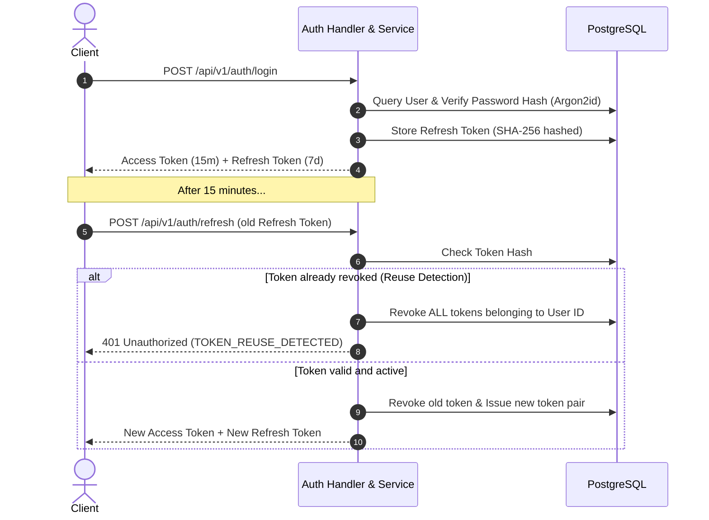

# Security Policy & OWASP API Security Top 10 Audit

This document details the security architecture, threat model mitigations, and compliance review for the **Task Manager REST API** against the **OWASP API Security Top 10 (2023)**.

---

## 1. Security Architecture Overview

The Task Manager REST API is designed with defense-in-depth security principles across all layers:
- **Network & Gateway Layer**: OWASP Security Headers (CSP, HSTS, X-Frame-Options, X-Content-Type-Options), CORS allowlisting, and per-client IP Token Bucket rate limiting.
- **Transport & Request Pipeline**: Strict 2MB request body ceiling (`http.MaxBytesReader`), request context cancellation deadlines (`30s`), and IETF `Idempotency-Key` concurrency protection.
- **Authentication & Session Security**: Argon2id password hashing, Ed25519/HMAC-SHA256 JWT access tokens (15m TTL), and SHA-256 hashed refresh tokens with automatic token family revocation upon reuse detection.
- **Data Layer Isolation**: PostgreSQL connection pooling with `statement_timeout` (10s) and multi-tenant Anti-IDOR scoping (`WHERE id = $1 AND user_id = $2`) returning `404 Not Found`.

---

## 2. OWASP API Security Top 10 (2023) Compliance Matrix

| Vulnerability Category | Risk Level | Status | Implemented Protection Mechanisms |
| :--- | :--- | :--- | :--- |
| **API1:2023 Broken Object Level Authorization (BOLA / IDOR)** | High | **Protected** | User-scoped SQL queries (`WHERE id = $1 AND user_id = $2`). Anti-IDOR strategy returns RFC 9457 `404 Not Found` (never 403) to prevent object existence enumeration. |
| **API2:2023 Broken Authentication** | Critical | **Protected** | Argon2id password hashing (RFC 9106 recommended). Dual-token JWT flow (15m access / 7d refresh). Refresh tokens stored as SHA-256 hashes with automatic token reuse detection revoking all active sessions. |
| **API3:2023 Broken Object Property Level Authorization** | Medium | **Protected** | Strict DTO segregation (`CreateTaskRequest`, `UpdateTaskRequest`). No mass assignment (`c.ShouldBindJSON` strictly bounds permitted fields). Response DTOs strip sensitive database fields. |
| **API4:2023 Unrestricted Resource Consumption** | High | **Protected** | `MaxBytes(2MB)` payload ceiling. In-memory Token Bucket rate limiter on auth routes. Keyset cursor pagination caps `limit` at 100. Global `TimeoutMiddleware(30s)` and PostgreSQL `statement_timeout(10s)`. |
| **API5:2023 Broken Function Level Authorization (BFLA)** | High | **Protected** | Role-Based Access Control (`RequireRole("admin")`). User identity extracted exclusively from verified cryptographically signed JWT claims, not user-controllable headers or parameters. |
| **API6:2023 Unrestricted Access to Sensitive Business Flows** | Medium | **Protected** | Per-client IP rate limiting on `/api/v1/auth/*`. IETF `Idempotency-Key` header with in-flight mutual exclusion locking on `POST /api/v1/tasks` preventing replay attacks and duplicate resource creation. |
| **API7:2023 Server Side Request Forgery (SSRF)** | High | **Protected** | The service does not accept arbitrary external URLs for fetching or webhook execution. Internal database and cache services reside on isolated Docker networks with no outbound public exposure. |
| **API8:2023 Security Misconfiguration** | High | **Protected** | Reverse proxy trust disabled by default (`router.SetTrustedProxies(nil)`). CORS configured with explicit allowed origins (no wildcard `*`). OWASP security headers enforced (HSTS, CSP, Frame-Options DENY). RFC 9457 masks internal errors. |
| **API9:2023 Improper Inventory Management** | Low | **Protected** | Strict API versioning under `/api/v1/`. Interactive OpenAPI 3.0 / Swagger UI documentation at `/swagger/index.html`. Unauthenticated debug endpoints disabled in release mode. |
| **API10:2023 Unsafe Consumption of APIs** | Medium | **Protected** | Input parameter validation via `go-playground/validator/v10` and custom domain business rule validators before processing. Strongly typed DTO unmarshaling. |

---

## 3. Threat Modeling & Implementation Details

### 3.1 Anti-IDOR & Information Leak Prevention (API1)
In multi-tenant architectures, returning `403 Forbidden` when a user attempts to view a resource owned by another tenant leaks the information that the resource **exists**.
To counteract this threat:
- All repository queries require both `id` and `user_id`.
- If no row matches, the service returns `domain.ErrNotFound`, which maps to `404 Not Found`. An attacker cannot distinguish between a non-existent UUID and a resource owned by someone else.

### 3.2 Dual-Token Authentication & Session Revocation (API2)


### 3.3 IETF Idempotency-Key Mechanism (API6)
The API implements mutation idempotency via the `Idempotency-Key` header:
1. **Key Reservation**: When a mutation request arrives with `Idempotency-Key: <key>`, the middleware attempts an atomic insert into `idempotency_keys` with `params_hash = SHA256(body)` and `locked_at = NOW()`.
2. **Concurrent Request Handling**: If a simultaneous request arrives with the same key before the first completes, the second receives `409 Conflict` (`IDEMPOTENCY_IN_PROGRESS`).
3. **Payload Mismatch Detection**: If a client re-uses a key with altered request parameters, the middleware detects `params_hash != existing.params_hash` and rejects with `409 Conflict` (`IDEMPOTENCY_KEY_MISMATCH`).
4. **Cached Replay**: Once the first request succeeds (status 2xx or 4xx), the status code and serialized response body are saved. Subsequent retries receive the exact cached response with `Idempotent-Replayed: true`.

---

## 4. Automated Vulnerability Scanning & Tooling

The codebase is regularly validated using automated security scanners:

```bash
# 1. Dependency vulnerability audit
govulncheck ./...

# 2. Static security analysis (gosec)
docker run --rm -v "${PWD}:/app" -w //app golangci/golangci-lint:latest golangci-lint run ./...

# 3. Unit & Integration test suite with race detector
make test-race
make test-integration
```

All high and critical severity findings must be resolved prior to merging into `main`.
